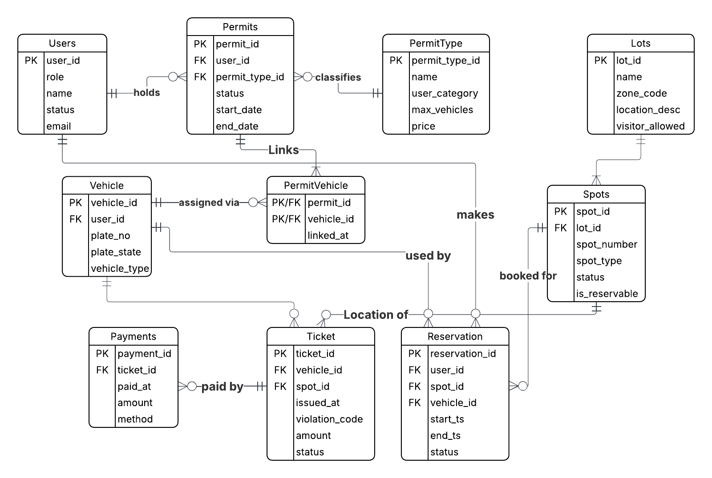

# UMBC Parking Management System

A PostgreSQL database project modeling campus parking operations: user and vehicle records, permit eligibility and issuance, parking lots and spaces, reservations, citations, payments, and sensor-based occupancy updates. The project includes SQL reporting, indexing experiments, a two-session concurrency demonstration, and a reproducible PostgreSQL/pgAdmin development environment using Docker Compose.

**Project type:** Academic database engineering project (SQL/PL/pgSQL; no web frontend or public API).

## Technology stack

- **PostgreSQL 16** — relational storage, integrity constraints, queries, views, PL/pgSQL functions, procedures, and triggers
- **SQL / PL/pgSQL** — data modeling and database workflows
- **Docker Compose** — local PostgreSQL and pgAdmin services
- **pgAdmin 4** — database exploration and multi-session transaction demonstration

## Database design

The database has **11 tables**: `users`, `vehicles`, `permit_type`, `permits`, `permit_vehicle`, `lots`, `spots`, `reservations`, `tickets`, `payments`, and `sensor_events`.



The conceptual ER diagram depicts the 10 core operational entities; the implemented schema also includes `sensor_events` to record occupancy events. Key relationships include:

- Each vehicle belongs to a user; a permit is issued to a user and refers to a permit type.
- `permit_vehicle` links permits and vehicles through a composite primary key.
- Lots contain parking spots; reservations reference a user, vehicle, and spot for a start/end time window.
- Tickets refer to vehicles and spots; payments refer to tickets, allowing multiple payments for a citation.
- Sensor events reference spots (and optionally vehicles), enabling event-driven occupancy updates.

The schema enforces basic integrity using primary and foreign keys, `UNIQUE`, `NOT NULL`, and `CHECK` constraints. Business-rule enforcement is partial; see [Scope and limitations](#scope-and-limitations).

## Implemented database features

### Permit issuance

The `issue_permit(...)` PL/pgSQL function checks that a user exists and is active, verifies that the selected permit type matches the user's role, validates dates, and checks for overlapping permits of the same type before inserting a permit.

### Sensor-driven occupancy

An `AFTER INSERT` trigger on `sensor_events` calls `apply_sensor_event_to_spot()` to mark a spot occupied or available according to an entry/exit or manual event, without overriding spots marked `maintenance` or `closed`.

### Automated citations

The `auto_ticketing(...)` procedure examines the latest sensor event per spot and inserts an unpaid `NO_PERMIT` citation for an occupied vehicle that lacks a valid active permit, while checking for an existing non-void ticket for that vehicle and spot on the scan date. The procedure must be invoked; it is not a continuously running background service.

### Reporting and query optimization

- Views: `current_active_permits` and `current_lot_availability`.
- Queries: permit holders, lot availability, reservation counts, vehicles without valid permits, unpaid ticket balances, and most recent sensor events.
- Indexes: lookup and filtering paths for vehicles, permits, reservations, tickets, payments, and sensor events.
- Query plans measured with `EXPLAIN (ANALYZE, BUFFERS)`.

In the coursework's small sample dataset, these measurements were reported:

| Query | Before indexing | After indexing | Observation |
| --- | ---: | ---: | --- |
| Unpaid ticket balance | 0.452 ms | 0.188 ms | Lower measured execution time |
| Reservation conflict lookup | 0.123 ms | 0.039 ms | Lower measured execution time (~68%) |
| Latest sensor event | 0.061 ms | 0.074 ms | Slightly slower despite lower estimated cost |

These are **small-dataset benchmark observations**, not production-scale performance claims. See `docs/report.pdf` for the coursework report and methodology.

## Concurrency: preventing double booking

`sql/transaction.sql` demonstrates two simultaneous reservation attempts for the same parking spot and overlapping time windows in **two pgAdmin Query Tool sessions**:

1. **Part A (without locking):** Both sessions can insert overlapping reservations and commit, demonstrating a double-booking race.
2. **Part B (with locking):** Both sessions acquire the same spot row using `SELECT ... FOR UPDATE`. The second waits; after the first commits, the second checks for the conflict and raises an exception rather than inserting another overlapping reservation.

This demonstrates a transaction-level locking approach, **not an automatically enforced rule for all inserts**. Any production reservation workflow would need to consistently use a concurrency-safe approach (such as a database exclusion constraint or an encapsulated transactional operation).

## Repository layout

```text
parking-management-system/
├── README.md
├── docker-compose.yml
├── sql/
│   ├── createDDL.sql
│   ├── dropDDL.sql
│   ├── loadAll.sql
│   ├── queryAll.sql
│   ├── indexAll.sql
│   └── transaction.sql
└── docs/
    ├── er-diagram.png
    └── report.pdf
```

The SQL files in the submitted coursework package include timestamped or numbered suffixes. **Rename them to the simplified filenames above** when organizing the GitHub repository, so the commands below work as written.

## Local setup

### Prerequisites

- Docker and Docker Compose
- Optional: a browser for the bundled pgAdmin interface

### 1. Start the services

From the repository root:

```bash
docker compose up -d
```

The Compose file starts PostgreSQL at `localhost:5432` and pgAdmin at <http://localhost:5050>.

Default **development-only** credentials in the supplied Compose file:

| Service | Setting | Value |
| --- | --- | --- |
| PostgreSQL | Database | `parking_db` |
| PostgreSQL | User | `parking_user` |
| PostgreSQL | Password | `parking_pass` |
| pgAdmin | Email | `admin@umbc.edu` |
| pgAdmin | Password | `adminpass` |

**Security:** These are hardcoded sample credentials for a local environment, **not suitable for deployment**. Change them and avoid publishing real credentials. In pgAdmin, connect to the database host `db` on port `5432` (the Docker service name), rather than `localhost`.

### 2. Create and populate the database

Run from the repository root:

```bash
docker compose exec -T db psql -v ON_ERROR_STOP=1 -U parking_user -d parking_db < sql/createDDL.sql
docker compose exec -T db psql -v ON_ERROR_STOP=1 -U parking_user -d parking_db < sql/loadAll.sql
```

Then run the reporting queries:

```bash
docker compose exec -T db psql -v ON_ERROR_STOP=1 -U parking_user -d parking_db < sql/queryAll.sql
```

To create the additional indexes:

```bash
docker compose exec -T db psql -v ON_ERROR_STOP=1 -U parking_user -d parking_db < sql/indexAll.sql
```

To compare before/after query plans, run the relevant `EXPLAIN` statements in `queryAll.sql` **before** and **after** running `indexAll.sql`, recording the results separately. Applying the indexes first removes the unindexed baseline.

**Reset:** `sql/dropDDL.sql` removes the project's tables, views, functions, and procedure. Run it only when you intend to delete the project data, then repeat the create/load sequence.

### 3. Run the two-session transaction demo

Open **two separate pgAdmin Query Tool windows** against the same database. Follow the annotated blocks in `sql/transaction.sql` in their prescribed session order:

1. Run the initial cleanup once.
2. Execute Part A Session 1 and Session 2 instructions, then inspect the results.
3. Run the cleanup between demos.
4. Execute Part B Session 1 and Session 2 instructions, committing Session 1 when Session 2 is waiting on the row lock; roll back Session 2 after the expected conflict exception.
5. Confirm only reservation `9003` remains from Part B.

**Do not run the entire transaction file as one script.** The steps are intentionally interleaved across two concurrent sessions.

### 4. Stop the environment

```bash
docker compose down
```

Docker volumes preserve local data. To remove volumes and **delete** the stored database and pgAdmin state, use `docker compose down -v` only if that is intended.

## Scope and limitations

- This project provides a database schema and SQL workflows, not a web UI, login system, or API.
- The roles in the data model are **not** database-enforced user permissions.
- The transaction file demonstrates how locking can prevent double booking; general reservation inserts are not automatically protected by that demonstration.
- Not all proposed cross-table business rules from the requirements document are implemented as database triggers or constraints.
- The permit and ticket routines use `MAX(id) + 1` for IDs; identity columns or sequences would be safer for concurrent inserts.
- Occupancy is modeled through inserted sensor events; this repository does not integrate with physical sensors.
- Query benchmarks use a small sample dataset and should not be extrapolated to production workloads.

## Documentation

The full academic report is in [`docs/report.pdf`](docs/report.pdf). It covers requirements, schema design, normalization, constraints, indexing experiments, and the concurrent-reservation demonstration.
